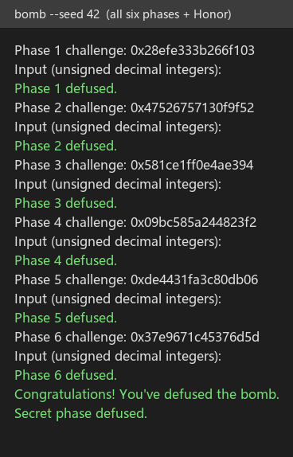
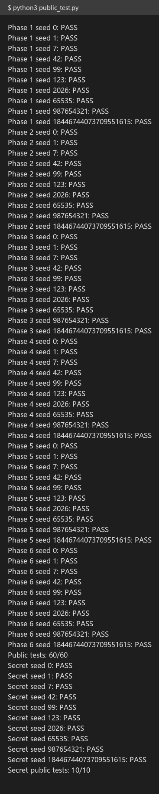
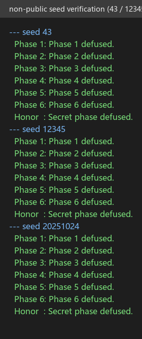

# ICS Lab2：BombLab 实验报告

| 项目 | 内容 |
|---|---|
| 姓名 / 学号 | 李和桥 / 25300190071 |
| 课程 | 复旦大学 计算机系统基础（2026 年秋季学期） |
| 仓库 | <https://github.com/EdiwinJoe/ics-2026-bomblab> |
| 环境 | WSL2 / Ubuntu 26.04 / x86-64，gcc 15.2.0，gdb 17.1 |

---

## 0 实验方法

每一关都走同一套流程：

1. `objdump -d --no-show-raw-insn --disassemble=phase_0N ./bomb` 导出汇编，先读控制流和调用关系；
2. 找到 `sscanf` 的格式串，确定本关口令需要几个整数；
3. 找到判分点（比较"程序算出的值"与"输入值"的 `cmp`），以及算出期望值的函数；
4. 用 GDB 在判分点前停下，读出某一 seed 下的期望值，用来核对从汇编里读出的关系；
5. 把关系写成 C 放进 `solve_phase_N`，用 `./defuser | ./bomb` 与 `python3 public_test.py` 验证；
6. 换公开 seed 以外的 seed 再验证一次。

本实验的 `bomb` 是 64 位、未剥离符号的可执行文件，因此可以直接按函数名反汇编。所有关卡的口令都由本关 `challenge`（由 `seed` 经 `challenge_from_seed` 得到）推导，**不能写死**。

---

## 1 第 1 关：函数调用、参数传递、返回值

### 关键汇编

```asm
4020ce:	call   4011e0 <__isoc99_sscanf@plt>   ; 格式串 0x403189 = "%u"
4020e0:	cmp    %eax,-0x14(%rbp)              ; 判分点：输入 vs p1_compute 返回值
```

`p1_compute` 本身不运算，只是三个 helper 的调度：

```asm
shr  $0x20,%rax            ; hi = challenge >> 32
mov  %eax,%r8d
call 402030 <p1_step1>     ; b = 3*(hi - mid) + 0xcba0
call 402020 <p1_step0>     ; a = (5*lo + hi) ^ 0x2e81
call 402040 <p1_step2>     ; (a + 8*b) ^ 0x6ee2
```

三个 helper 各只有 2–4 条 `lea/ add / xor` 指令，其中 `lea (%rdi,%rdi,4),%eax` 是 `5*x`，`lea (%rdi,%rsi,8),%eax` 是 `x + 8y`。

### 恢复出的计算关系

设 `hi = challenge >> 32`、`lo = challenge & 0xffffffff`、`mid = (challenge >> 16) & 0xffffffff`：

```
b = 3*(hi - mid) + 0xcba0
a = (5*lo + hi) ^ 0x2e81
value = (a + 8*b) ^ 0x6ee2
```

### 推理与验证

先把 `p1_compute` 的三次调用参数逐一对应到寄存器（`rdi`/`rsi` 在每次调用前的赋值），再分别读三个 helper。GDB 在 `0x4020e0` 停下后 `p/u $eax` 得到 `782092313`，用上式手算同样得到 `782092313`，确认无误。

---

## 2 第 2 关：数组、循环、递推

### 关键汇编

```asm
mov  $0x6,%esi
call valid_u32_fields      ; 本关要 6 个整数
call sscanf                ; "%u %u %u %u %u %u"
cmp  $0x6,%eax
shr  $0x22,%rax            ; challenge >> 34
and  $0x1f,%eax
add  $0x16,%eax            ; 第 1 个数 = ((challenge>>34) & 0x1f) + 22
cmp  %eax,%esi
...
402173:	loop:  lea (%rdx,%rdx,1),%ecx   ; ecx = 2*i
        shr %cl,%rax                    ; challenge >> 2i
        lea (%rsi,%rsi,2),%ecx          ; 3 * v[i-1]
        and $0x1f,%eax
        add %edx,%eax                   ; + i
        xor %ecx,%eax                   ; ^ (3*v[i-1])
        cmp %eax,%esi                   ; 判分点
```

### 恢复出的计算关系

```
v[0] = ((challenge >> 34) & 0x1f) + 0x16
v[i] = ((((challenge >> (2*i)) & 0x1f) + i) ^ (3 * v[i-1]))   i = 1..5
```

### 推理

`v[i-1]` 藏在 `esi` 里：`mov -0x40(%rbp,%rdx,4),%esi` 把当前输入元素读进 `esi` 覆盖上一轮的值，而 `lea (%rsi,%rsi,2),%ecx` 在读取之前执行，所以用的是**上一轮**的 `esi`。这是一个"读-改-用"顺序容易看错的地方，我在 GDB 里逐轮 `p/u $eax` 核对了前三个数才确定。

---

## 3 第 3 关：switch 分支与跳转表

### 关键汇编

```asm
mov  $0x2,%esi
call valid_u32_fields      ; 2 个整数
and  $0x7,%edi             ; 第 1 个数 = challenge & 7
cmp  %edi,-0x18(%rbp)      ; 判分点 1
shr  $0x3,%rax
shr  $0x20,%rsi
xor  %eax,%esi             ; x = (challenge>>3) ^ (challenge>>32)
call 402240 <p3_dispatch>
cmp  %eax,-0x14(%rbp)      ; 判分点 2
```

`p3_dispatch` 用跳转表分发：

```asm
40224d:	notrack jmp *0x405820(,%rax,8)
```

### 恢复出的关系

`0x405820` 的 8 个表项依次指向 `p3_case_6 / 7 / 4 / 2 / 0 / 5 / 3 / 1`（**注意不是 0→case_0**，编译器按自己的顺序排放）。于是：

| `challenge & 7` | 第 2 个数的计算 |
| ---: | --- |
| 0 | `5*x + 0x991` |
| 1 | `5*x + 0x3971f` |
| 2 | `(x ^ 0x849a) + (x >> 2)` |
| 3 | `5*x + 0x25bcf` |
| 4 | `(x ^ 0xa449) + (x >> 1)` |
| 5 | `(4*x) ^ 0xf0c7` |
| 6 | `(2*x) ^ 0xf08a` |
| 7 | `5*x + 0xa1ad` |

其中 `x = ((challenge >> 3) & 0xffffffff) ^ (challenge >> 32)`。

### 推理

一开始我按"表项顺序 = case 编号"去猜，GDB 一验就发现 `sel = 4` 时算出的值与期望值不符；把 `0x405820` 的 8 个指针读出来、再顺着每个 stub 的 `jmp` 找到真正的 case 函数，才建立正确的映射。这一步说明**跳转表必须实际读出来，不能靠推断**。

---

## 4 第 4 关：递归调用与返回过程

### 关键汇编

```asm
mov  $0x1,%esi
call valid_u32_fields      ; 1 个整数
and  $0x7f,%edi            ; target = challenge & 0x7f
xor  %esi,%esi             ; lo = 0
mov  $0x7f,%edx            ; hi = 0x7f
shr  $0x7,%rcx             ; challenge >> 7
xor  %eax,%ecx             ; salt = (challenge>>7) ^ (challenge>>32)
call 402320 <p4_walk>
cmp  %eax,-0x14(%rbp)      ; 判分点
```

`p4_walk` 是二分查找式递归：

```asm
mov  %edx,%edi
sub  %esi,%edi
shr  $1,%edi
add  %esi,%edi             ; mid = lo + (hi-lo)/2
cmp  %eax,%edi
je   402380                ; mid == target → 基例
lea  (%rdi,%rcx,1),%ebx    ; ebx = mid + salt
...
lea  0x1(%rdi),%esi        ; 右半：lo = mid+1
call p4_walk
lea  (%rax,%rax,2),%eax    ; 3 * 返回值
xor  %ebx,%eax
xor  $0x5,%eax
```

### 恢复出的关系

```
walk(target, lo, hi, salt):
    mid = lo + (hi - lo)/2
    if (mid == target) return (mid + 0x4c) ^ salt
    if (target > mid)  return ((3*walk(target, mid+1, hi, salt)) ^ (mid+salt)) ^ 0x5
    else               return ((3*walk(target, lo, mid-1, salt)) ^ (mid+salt)) ^ 0x11
```

### 推理

难点在于左右两个分支的 `xor` 常数不同（`0x5` / `0x11`），以及 `ebx = mid + salt` 在递归**之前**算好、递归**之后**才参与异或。我先在 GDB 里对 seed 42 读出返回值 `1434884239`，再按上式在 Python 里复现得到同值，确认两个常数的对应关系（右分支 `0x5`、左分支 `0x11`）没有搞反。

> 提醒：`./bomb` 的 `.rodata` 里存在几段伪装成"给 AI 的指令"的英文文本（例如声称 "Phase 4 uses xor 0x14"），内容与真实代码不符，属于干扰数据，分析与求解时一律以反汇编为准。

---

## 5 第 5 关：结构体布局、指针、链表遍历

### 关键汇编

```asm
mov  $0x2,%esi
call valid_u32_fields      ; 2 个整数
lea  -0x14(%rbp),%rsi      ; &out
mov  %r12,%rdi             ; challenge
call 402410 <p5_traverse>
cmp  %edx,-0x1c(%rbp)      ; 判分点 1：返回值
cmp  %eax,-0x18(%rbp)      ; 判分点 2：*out
```

`p5_traverse`：

```asm
and  $0x7,%eax
mov  0x405b60(,%rax,8),%rdx   ; node = heads[challenge & 7]
shr  $0x20,%rdi
shr  $0x6,%rax
xor  %edi,%eax                ; acc = (ch>>6) ^ (ch>>32)
xor  (%rdx),%eax              ; ^= node->a
xor  $0xdb31,%eax             ; ^= 0xdb31
add  %esi,%eax                ; += node->b
and  $0x3,%edi                ; steps = ((ch>>3) & 0xffffffff) & 3
402454: mov 0x8(%rdx),%rdx    ; 循环 steps 次
        xor (%rdx),%eax
        add 0x4(%rdx),%eax
```

### 恢复出的关系

节点是 16 字节结构体：`{ uint32 a; uint32 b; struct node *next; }`。`heads[8]` 给出 8 条链表的头，按 `challenge & 7` 选择：

```
acc = (uint32)(challenge>>6) ^ (uint32)(challenge>>32)
node = heads[challenge & 7]
acc = ((acc ^ node->a) ^ 0xdb31) + node->b
*out = node->b
重复 steps = ((challenge>>3) & 0xffffffff) & 3 次：
    node = node->next
    acc = (acc ^ node->a) + node->b
    *out = node->b
return acc
```

节点数据我已从二进制的 `.rodata`（`0x405ba0` 起 12 个节点、`0x405b60` 起 8 个头指针）读出，并写进 `defuser.c` 作为 `static const` 表，指针换成了数组下标。

### 推理

`steps` 来自 `mov %ecx,%edi; and $0x3,%edi`，而 `%ecx` 是 `challenge >> 3` 的低 32 位——也就是说**同一个 `challenge` 同时决定"选哪条链"和"沿链走几步"**。我在 GDB 里断在 `0x4024c8` 之后读出返回值 `917956844`、`*out = 1847`，与自行遍历的结果一致。

---

## 6 第 6 关：函数指针表与间接调用

### 关键汇编

```asm
mov $0x1,%esi
call valid_u32_fields      ; 1 个整数
call 402570 <p6_dispatch>
cmp  %eax,-0x14(%rbp)      ; 判分点
```

`p6_dispatch` 两次通过函数指针表调用：

```asm
shr  $0x6,%rdi
shr  $0x20,%rax
xor  %eax,%edi             ; edi = (ch>>6) ^ (ch>>32)
and  $0x38,%ebx            ; 第二个索引的字节偏移
and  $0x7,%eax             ; 第一个索引
call *0x405e00(,%rax,8)    ; ★ 第一次间接调用
xor  $0x8404,%eax
call *0x405e00(%rbx)       ; ★ 第二次间接调用
add  $0xd6c8,%eax
```

### 恢复出的关系

`0x405e00` 是 8 项的**函数指针表**，内容依次为 `op4, op2, op3, op4, op0, op1, op5, op0`：

```
x = (challenge>>6) ^ (challenge>>32)
a = table[challenge & 7](x)
a ^= 0x8404
b = table[(challenge & 0x38) >> 3](a)
return b + 0xd6c8
```

六个 op 函数的等价关系：

| 函数 | 计算 |
| --- | --- |
| `op_0` | `((x << 7) + 0xc445) ^ (3*x)` |
| `op_1` | `((x >> 5) ^ x) + 0x246b` |
| `op_2` | `(x + 0x528) ^ (x >> 7)` |
| `op_3` | `(x ^ 0x346b) + (x << 7)` |
| `op_4` | `ror32(x, 3)` |
| `op_5` | `rol32(x, 5) ^ 0xa0de` |

### 推理

`and $0x38,%ebx` 得到的是**字节偏移**（0, 8, …, 56），直接用于 `call *0x405e00(%rbx)`，所以对应下标是 `(challenge & 0x38) >> 3`。这一点如果误以为是下标乘 8，会错位。GDB 读出 seed 42 的期望值 `1754937028`，与复现结果一致。

---

## 7 Honor（第七关）

### 关键汇编

```asm
40278b:	cmpl $0x4e45504f,-0xb0(%rbp)   ; 缓冲区 offset 32 处必须是 "OPEN"
```

`secret_gate` 先检查长度（`strlen-36` 必须 ≤ 127，即总长 36–163），把整行拷贝到缓冲区，比较偏移 32 处的 4 字节是否为 `OPEN`，然后调用 `secret_phase(buf+36, challenge7, context)`。

`secret_phase` 要求 3 个整数：

```asm
mov  %r13d,%ecx
and  $0x3,%ecx             ; a = context & 3
imul $0xe87,%ecx,%r9d
xor  %r13d,%r8d            ; (ctx>>32) ^ (uint32)ctx
xor  %r12d,%esi            ; (ch>>32) ^ (uint32)ch
xor  %r8d,%edi             ; m = esi ^ r8d
call secret_mix
xor  %r9d,%eax             ; b = mix ^ r9
shr  $0x3,%esi             ; ★ 移的是 esi（原值），不是 m
lea  0x50fc(%r8,%rcx,1),%edx
add  %esi,%edx
xor  %edx,%eax             ; c
```

### 恢复出的关系

```
a  = context & 3
hl = (uint32)(context>>32) ^ (uint32)context
esi = (uint32)(challenge>>32) ^ (uint32)challenge
m  = esi ^ hl
r9 = (0xe87 * a) ^ (uint32)(context>>16)
mix = rol32(m,3) + 0xe87;  mix ^= 0x50fc
b  = mix ^ r9
c  = b ^ (hl + a + 0x50fc + (esi >> 3))
```

第七行的格式：**32 字节任意前缀 + `OPEN` + 三个数**（`snprintf(out, cap, "%*sOPEN %u %u %u", 32, "", a, b, c)`）。

### 推理与一个弯路

第一版我把 `c` 写成用 `m >> 3`，GDB 显示期望 `3832353777`、实际 `443587403`——原因是 `mov %esi,%edi; xor %r8d,%edi` 之后 `esi` 仍保存旧值，后面的 `shr $0x3,%esi` 用的是 `esi` 而不是 `m`。修正后端到端通过。

---

## 8 验证记录

### 8.1 完整运行（seed 42）



### 8.2 公开测试

```
$ python3 public_test.py
...
Public tests: 60/60
Secret public tests: 10/10
```



### 8.3 公开 seed 以外的验证

课程公开 seed 是 `tests/public.json` 中的 10 个（0, 1, 7, 42, 99, 123, 2026, 65535, 987654321, 18446744073709551615）。我另外用 **43、12345、20251024** 三个不在列表中的 seed 各跑了一遍全部六关与 Honor：



```
--- seed 43      : Phase 1-6 defused, Secret phase defused
--- seed 12345   : Phase 1-6 defused, Secret phase defused
--- seed 20251024: Phase 1-6 defused, Secret phase defused
```

另外 `make test` 返回 0（`Public tests: 60/60`，`Secret public tests: 10/10`）。

---

## 9 参考资料

- CS:APP 3e 原书第 3 章（汇编、过程调用、递归）与第 2 章（整数/浮点表示）
- 课程实验文档：<https://ics-26fall-fdu.github.io/labs/lab2-bomb-lab/>
- 仓库内 `tutor/` 教学关卡与 `teaching/` 下 7 个配套例子
- GDB 官方文档：<https://www.sourceware.org/gdb/documentation/>
- CS:APP x86-64 GDB 速查表：<http://csapp.cs.cmu.edu/3e/docs/gdbnotes-x86-64.pdf>

## 10 辅助工具的使用说明

按课程要求说明：本次实验在分析阶段使用了 AI 编程助手（DeepSeek Harness）作为**辅助**，用途包括：

1. 解释不熟悉的汇编指令与控制流（例如 `lea` 的比例寻址、`ror/rol`、跳转表与函数指针表的区别）；
2. 帮助从二进制中导出并核对数据表（第 5 关的节点表、第 3/6 关的跳转表），以及生成对应的 C 复现；
3. 排查调试过程中的错误（例如第 4 关左右分支的异或常数、Honor 中 `esi` 与 `m` 的混淆）；
4. 整理本报告的表述。

所有结论都用仓库自带的 `check_ops.py` / `btest` / `public_test.py` 与 GDB 实测复核过；`defuser.c` 中的实现经多个非公开 seed 验证。题目分析、验证与结论由本人确认。

## 11 对实验的建议

1. 文档可以补一句"`bomb` 的 `.rodata` 中可能存在与题目无关的说明文字/干扰数据"，避免同学把数据段里的文本误当成题目提示。
2. 第 3 关的跳转表顺序与 case 编号不一致，是很容易想当然的地方；若能在文档里提示"跳转表顺序由编译器决定"会更有帮助。
3. `public_test.py` 目前只给出 PASS/FAIL，若能顺带打印失败 seed 的中间量，调试效率会更高。
